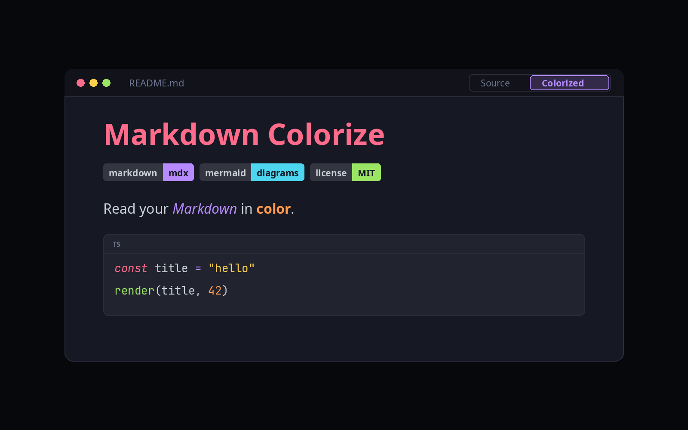

# Markdown Colorize

A colorful, read-only view for Markdown and MDX files. It adds a **Colorized** view beside **Source** in the editor tab.



- **Colored headings, quotes, tables, task lists and callouts** (`> [!NOTE]`, `[!TIP]`, `[!WARNING]` and more).
- **Code blocks** highlighted for 25+ languages, with a Copy button.
- **Math** with `$inline$`, `$$display$$` and `math` blocks.
- **Diagrams** from `mermaid` blocks, drawn in the page's colors.
- **Badges** from shields.io and similar, drawn as colored pills.
- **MDX:** `import`, `export` and JSX show as code; the Markdown around them stays Markdown.
- **Toolbar:** Outline, Auto/Dark/Light, Narrow and Dim. Full width and vivid colors are the defaults.

## Use it

1. Install **Markdown Colorize** from **Settings → Plugins**.
2. Open a `.md`, `.markdown` or `.mdx` file.
3. Choose **Colorized** beside **Source**. `.mdx` files open in it by default.

Edit in **Source**; the Colorized view updates when the file changes. Toolbar choices, fonts and text size are saved in the plugin's settings. Orca doesn't share its fonts with plugins, so type your font names there.

## Limits

- Only images embedded in the Markdown (`data:` addresses) are drawn. Web images and files next to the document can't be loaded, so they show their alt text.
- Raw HTML is cleaned to a short list of safe tags. MDX components are shown as code, not run.
- `.md` can't open in Colorized by default; Orca opens it in its own view first.

## Develop

```sh
npm install
npm run build   # bundles src/ into editor/vendor/
orca plugin validate .
orca plugin dev watch .
```

Samples are in `examples/`.

## License

MIT. See [LICENSE](LICENSE) and [THIRD_PARTY_NOTICES.md](THIRD_PARTY_NOTICES.md).
