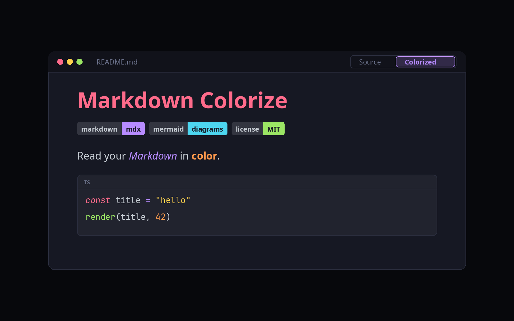

# Markdown Colorize

A colorful, editable view for Markdown and MDX files. It adds a **Colorized** view beside **Source** in the editor tab.

- **Colored headings, quotes, tables, task lists and callouts** (`> [!NOTE]`, `[!TIP]`, `[!WARNING]` and more, plus Obsidian kinds like `[!info]` or `[!bug]` and a custom title: `> [!tip] My title`).
- **Tables you can edit in place:** click a cell and type. Tab and Shift+Tab move between cells (Tab in the last cell adds a row), the up and down arrows move between rows, and Enter or Esc leaves. Right-click a cell (or press Shift+F10) to add or delete rows and columns, or to edit the table as Markdown. The table keeps its style (lined-up columns stay lined up), and each visit is one undo step.
- **Task lists you can tick:** click a `- [ ]` box to tick or clear it in the file (`Ctrl/Cmd+Z` takes it back); click the text to edit the item.
- **Footnotes** (`[^1]` with `[^1]: note`), `==highlighted==` text and `:emoji:` shortcodes.
- **Front matter** shown as a property list: keys, values and tag chips.
- **Code blocks** highlighted for 25+ languages, with a Copy button.
- **Math** with `$inline$`, `$$display$$` and `math` blocks.
- **Diagrams** from `mermaid` blocks, drawn in the page's colors.
- **Images** from files next to the document (`./img/a.png`, `/docs/a.png` from the workspace root) and from the web, plus `` tags with their `width`.
- **Badges** from shields.io and similar: fixed badges are drawn as colored pills, live ones (build status, version) load the real badge.
- **MDX:** `import`, `export` and JSX show as code; the Markdown around them stays Markdown.
- **Click to edit:** click any block (a paragraph, heading, list, table or code block) and it turns into an editor showing that block's Markdown, in color. Click away or press Esc to see it formatted again. `Ctrl/Cmd+B` and `Ctrl/Cmd+I` toggle bold and italic, and `Ctrl/Cmd+click` opens a link.
- **Undo and redo** for the whole page (`Ctrl/Cmd+Z`, `Ctrl/Cmd+Shift+Z` or the toolbar buttons): each editing session is one step. The steps are cleared if another tool changes the file.
- **Keyboard:** Tab reaches the page, the arrow keys move between blocks, Enter edits the focused block, Esc leaves it, and the arrow keys carry on into the next block while editing. Tab indents a list item, and in a table it moves to the next cell (a new row after the last). Pasting a web address over selected text makes it a link.
- **Find:** `Ctrl/Cmd+F` or the Find button searches the file, highlights every match, and steps through them with Enter and Shift+Enter.
- **Outline** highlights the heading you are reading.
- **Toolbar:** Outline, Auto/Dark/Light, Narrow and Dim. Full width and vivid colors are the defaults.

## Use it

1. Install **Markdown Colorize** from **Settings → Plugins** and approve what it asks for (see below).
2. Open a `.md`, `.markdown` or `.mdx` file.
3. Choose **Colorized** beside **Source**. `.mdx` files open in it by default.

Changes save as you type, and the view follows edits made elsewhere. Toolbar choices, fonts and text size are saved in the plugin's settings. Orca doesn't share its fonts with plugins, so type your font names there.

## What it can access

An Orca editor gets the open file's text but not its path, and has no file system or network. To show images, the plugin runs a small Node.js worker (`worker.mjs`, built from `src/worker` and not minified), which is why Orca asks you to approve running code and reading your workspaces:

- **Workspaces** (`workspace:read`): the worker lists your local workspaces to find the open file, by matching its text against the Markdown files in them.
- **Files**: it reads image files (by file type) inside your local workspaces only, never from a `.git` folder. It writes nothing.
- **Network**: web images are downloaded only from public addresses, never from your machine or private network (redirects are checked too), up to 32 MB each. Turn this off with the **Web images** setting.

## Limits

- An image that can't be found or downloaded shows its alt text. A path starting with `/` is read from the root of the Orca workspace the file is in, which may be a folder above the repository.
- Raw HTML is cleaned to a short list of safe tags. MDX components are shown as code, not run.

## License

MIT. See [LICENSE](LICENSE) and [THIRD_PARTY_NOTICES.md](THIRD_PARTY_NOTICES.md).
