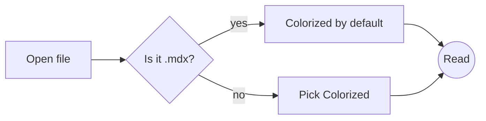
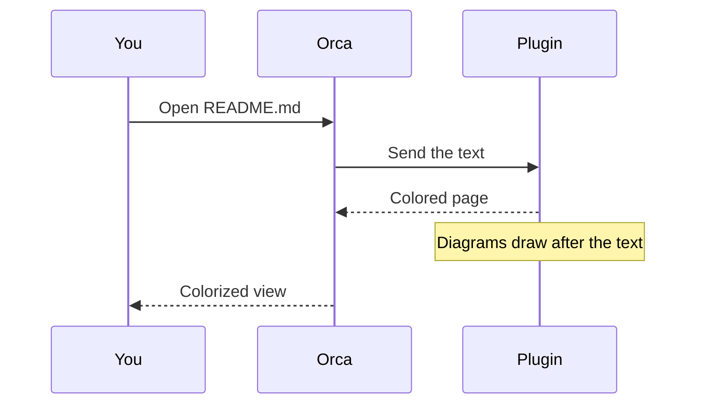
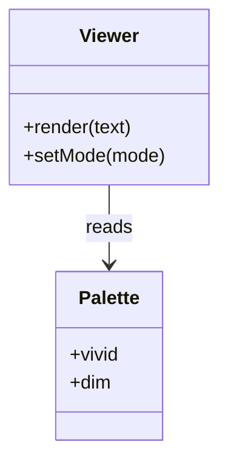
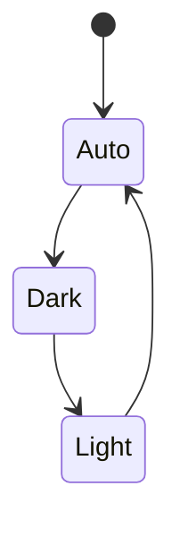
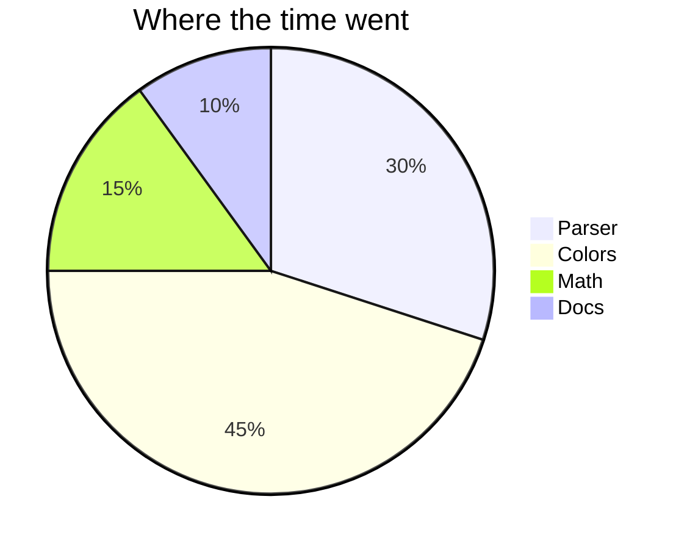

# Diagrams

Write a fenced block with the language `mermaid` and the Colorized view draws it, in the page's colors.

## Flowchart



## Sequence



## Class diagram



## State



## Pie



## A broken diagram shows its error and source

```mermaid
flowchart LR
  A --> 
```
